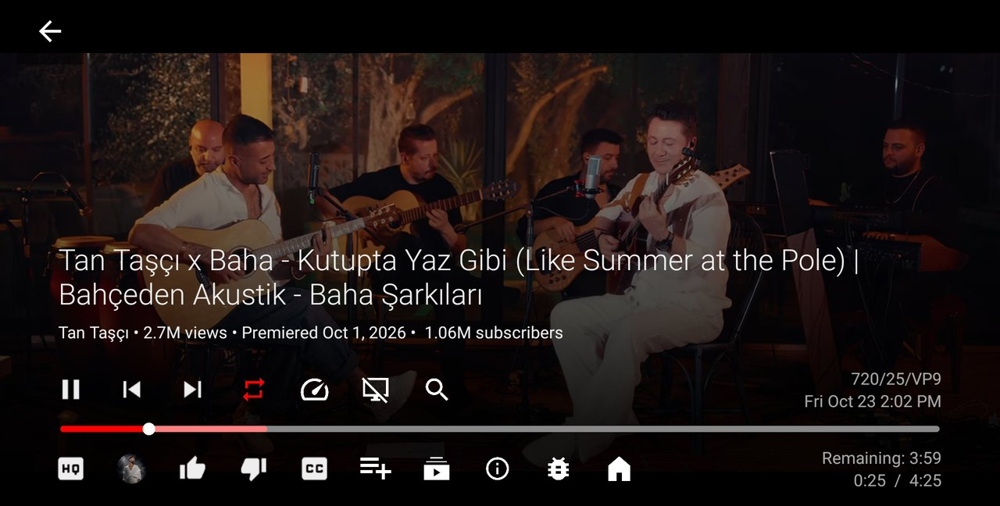

<p align="center"></p>
<h1 align="center">M2Y Tube</h1>
<p align="center"><b>A touch-first, lightweight YouTube client for the BYD multimedia screen</b><br><sub>BYD multimedya ekranı için dokunmatik öncelikli, hafif YouTube istemcisi · Лёгкий YouTube-клиент для мультимедийного экрана BYD с управлением касаниями</sub></p>
<p align="center">
  <a href="https://github.com/mehmetmesut/byd-m2y-tube/releases/latest"></a>
  <a href="https://github.com/mehmetmesut/byd-m2y-tube/releases"></a>
  
  
  
  
</p>
<p align="center">
  <a href="https://github.com/mehmetmesut/byd-m2y-tube/releases/download/1.25.07.68.2/M2YTube_1.25.07.68.2_arm64-v8a.apk"><b>⬇ Download APK (18.0 MB)</b></a> ·
  <a href="https://byd.mehmetmesut.com">byd.mehmetmesut.com</a> ·
  <a href="https://github.com/mehmetmesut/byd-m2y">⭐ All M2Y apps for BYD</a>
</p>
<p align="center"> </p>

<details open>
<summary><b>🇬🇧 English</b></summary>

### Why this app

I built these apps first for **my own BYD SEAL U DM-i**, because the store apps did not fit the car: ads, Google Play dependencies, phone and TV layouts, and a heavy load on the CPU. The official YouTube app does not run on the head unit at all (no Google services), and the existing TV clients are made for a remote control and a 4K television. M2Y Tube is a fork of [SmartTube](https://github.com/yuliskov/SmartTube) rebuilt around a **1920×1080 touch screen in a car**: big touch targets, swipe gestures, a hard quality cap that the decoder can really handle, and an audio-only **Music** mode for driving. Then I made it installable and usable on **BYD multimedia screens (DiLink)** and share it **free, without ads, without tracking**, built with care to use **as little of the head unit's CPU, RAM and storage as possible**, fast to open, smooth to touch, stable.

### Highlights

- **Touch first.** Tap the picture to pause or resume, swipe left/right for the previous/next video, swipe up for suggestions, swipe down to hide the controls. A back arrow top-left, a Home button in the player and an **X** on every panel replace the remote.
- **Quality that fits the screen.** Never above **1080p60**, never below 360p; AV1, HDR, 2K and 4K are not offered. Default is **480p30 VP9** on the hardware decoder.
- **Music mode.** One entry in the quality list turns the video track off, shows the cover and plays audio only: less data and less decoding.
- **Plays on while you navigate.** Background audio is on by default; the Home button leaves the player while the video keeps playing.
- **Works offline too.** Save a video from the player (360p–1080p) or simply watch it to the end: the last 5 videos watched to the end are kept from the stream itself (no extra data) and play without internet. Left menu: **Saved** and **In memory**.
- **Ad-free, no tracking.** No ads without signing in and none when you sign in with your own YouTube account; no analytics, no crash reporting, no update checker.
- **Light on the head unit.** No Google Play services, no card shadows or zoom animations, thumbnails kept in memory, no boot or screen-on receiver of its own.

### Features

**Playback**
- Video quality from **360p to 1080p60**. A video that only exists below 360p keeps all its formats and plays at the best one available.
- Default quality 480p30 (VP9, hardware decoded); you can change it per video from the quality list.
- AV1, HDR and anything above 1080p or 60 fps are hidden for good. The "unlock all formats" tweak does not bring them back.
- **Music** quality: the video track is off, the video's cover is shown (audio only, less data and decoding).
- **Speed list:** 0.1, 0.25, 0.5, 0.75, 1, 1.25, 1.5, 1.75, 2 and 4×.
- **Background audio** on by default; controls auto-hide after 6 seconds, enough to reach a button by touch.

**Offline**
- **Save** button next to search in the player: pick a quality (360p–1080p, VP9 before H.264); the download runs in the background with a progress ring. Up to 8 GB; the least recently watched go first.
- **In memory:** the last 5 videos watched to the end are kept automatically from the stream, byte-identical to YouTube's files, at no extra data cost. When a sixth one starts, the oldest is removed at once.
- Without internet the app opens Saved (or In memory) instead of an error page.
- **Search:** one tap on a suggestion searches it at once and closes the keyboard.

**Touch controls and gestures**
- With the controls hidden the first tap only shows them; with the controls visible a tap on the picture pauses or resumes.
- Swipe left to right: previous watched video (or back, if there is none). Swipe right to left: next video.
- Swipe up: opens the suggestions. Swipe down on the controls: hides them and leaves the video.
- A **back arrow** at the top left of the player, same as the system Back button. A **Home** button as the last button of the controls row opens the YouTube home page while the current video keeps playing.
- Every settings, quality or statistics dialog has an **X** that closes the whole dialog (all nested levels) in one tap. A tap on the video beside an open panel pauses or resumes without closing the panel.
- **Quality and speed lists** open as a compact list right above their buttons; the full dialog stays one tap away ("More settings…").

**Account and content**
- Works signed out, or signed in to your own YouTube account with the TV code (no Google services needed).
- **SponsorBlock** and **DeArrow** support inherited from SmartTube.
- The About screen shows the author, the target car, the source repository and the upstream credit.

**Lean by design**
- Built without Google Play services, Firebase or Crashlytics; arm64 only on the car.
- No update checker, no package installer bridge, no Android TV programme-guide access.
- Card shadow wrappers, zoom animations on touch and rounded-corner clipping are off; a 100 MB thumbnail cache and the in-memory cache keep a long feed from decoding the same pictures again.
- The likes counter and the section playlist are off by default (one request less per video, no GC stutter).

### Built for the head unit

| Head unit fact (measured over ADB) | Design decision |
|---|---|
| Android 10 (API 29), arm64-v8a, no Google services | Built without Google Play services, Firebase or Crashlytics; arm64 only |
| Qualcomm SM6125 (8 cores, 4×1.8 + 4×2.0 GHz), Adreno 610, 8 GB RAM | No card shadows, zoom or rounded-corner clipping; thumbnails kept in memory; the boot / screen-on receiver of the original app is removed |
| Hardware decoders: AVC, HEVC, VP9 (no AV1); 1080p up to about 120 fps | Quality capped at **1080p60**; AV1, HDR, 2K and 4K never offered or chosen; **480p30 VP9** by default |
| 1920×1080 landscape touch screen, 240 dpi, 60 Hz, no remote | Tap and swipe gestures, back arrow, Home button, an **X** on every panel, lists above their buttons |
| Music while driving | Background audio on by default; **Music** mode with the video track off |

### Install

Head unit with wireless ADB enabled (step-by-step guide on [byd.mehmetmesut.com](https://byd.mehmetmesut.com)):

```
adb connect <car-ip>:5555
adb install -r M2YTube_1.25.07.68.2_arm64-v8a.apk
```

- **Windows one-click installer:** [m2y-kurulum.cmd](https://byd.mehmetmesut.com/m2y-kurulum.cmd) asks for the car's IP, downloads Google's platform-tools if they are missing, downloads the apps you choose, verifies their SHA-256 and installs them.
- **Direct install from the car's browser** only works on head units whose **stock BYD package installer has been unlocked** (the stock one blocks third-party APKs with a "driving safety" notice). The project does not distribute any BYD files.
- All M2Y APKs are signed with the same M2Y key, so an update installs over the previous version and keeps your settings.
- After installing, the SealNav / stock launcher may need a restart before it shows the new icon.
- **First run:** open M2Y Tube; signing in is optional (Settings → sign in with the TV code). To listen only, pick **Music** in the quality list of the player.
- Download and SHA-256 sums: [byd.mehmetmesut.com](https://byd.mehmetmesut.com) · all releases: [GitHub Releases](https://github.com/mehmetmesut/byd-m2y-tube/releases).

### Privacy & permissions

The app has no backend of its own. It talks to YouTube / Google servers to play videos and to the community services below, and never sends data to the author.

| Permission | Why |
|---|---|
| `INTERNET`, `ACCESS_NETWORK_STATE` | Load videos and metadata from YouTube; check the connection |
| `RECORD_AUDIO` | Voice search (optional; the microphone is not required) |
| `FOREGROUND_SERVICE`, `FOREGROUND_SERVICE_MEDIA_PLAYBACK`, `WAKE_LOCK`, `POST_NOTIFICATIONS` | Keep audio playing in the background |
| `READ_EXTERNAL_STORAGE`, `WRITE_EXTERNAL_STORAGE` | Back up and restore your settings |
| `ACCESS_VIDEO_DATA` (signature level, own) | Reserved for the app's own components; no other app can use it |
| `RECEIVE_BOOT_COMPLETED`, `QUICKBOOT_POWERON`, `SYSTEM_ALERT_WINDOW`, `ACTION_MANAGE_OVERLAY_PERMISSION`, `BLUETOOTH`, `DYNAMIC_RECEIVER_NOT_EXPORTED_PERMISSION` | Declared by the upstream code base; M2Y's own features do not need them and the app's boot / screen-on receiver is removed |

Removed from the original app: `REQUEST_INSTALL_PACKAGES`, `REQUEST_DELETE_PACKAGES` and the Android TV programme-guide permissions (`READ_EPG_DATA`, `WRITE_EPG_DATA`).

- **Never collected:** no analytics, no telemetry, no crash reporting, no advertising ID, no update checks, no personal data sent to the author. Sign-in tokens stay in the app's local storage on the head unit.
- **Sign-in** uses the public OAuth client data that SmartTube publishes in its `constants.json`; no account data goes to M2Y.
- **Community services (read-only, no account data):** SponsorBlock receives the ID of the video you watch to return skip segments (on by default, can be switched off in the settings); DeArrow does the same for community titles and thumbnails when you enable it; Return YouTube Dislike receives the video ID only if you switch the likes counter on (off by default in M2Y). See [PRIVACY.md](PRIVACY.md) for the upstream policy text.

### Compatibility

Designed and tested on the BYD SEAL U DM-i (DiLink 3.0). Other BYD models with an Android 10+ arm64 multimedia screen are expected to work but are not tested.

### Build from source

```
git clone --recursive https://github.com/mehmetmesut/byd-m2y-tube.git
cd byd-m2y-tube
git -C MediaServiceCore apply ../m2y-patches/MediaServiceCore.patch
git -C SharedModules apply ../m2y-patches/SharedModules.patch
# JDK 17, Android SDK platform 34, build-tools 30.0.3
./gradlew :smarttubetv:assembleStfdroidRelease
```

Output: `smarttubetv/build/outputs/apk/stfdroid/release/M2YTube_fdroid_<version>_arm64-v8a.apk`. For the Android emulator add `'x86_64'` to `splits.abi` in `smarttubetv/build.gradle`. M2Y's changes to the two submodules are kept as patches in `m2y-patches/` (applied above). Signing reads a properties file outside the repository (`m2y.signingProps` in `local.properties`).

### From the author

I wanted YouTube on the screen of my own BYD SEAL U DM-i, without ads, without a phone layout and without a heavy load on the head unit. When it worked well in my car, I made it available for other BYD multimedia screens and share it free, without ads and without tracking, built to use as little CPU, RAM and storage as possible. If it makes your drives better, a ⭐ on the [hub of all M2Y apps](https://github.com/mehmetmesut/byd-m2y) is the nicest thank-you.

**Yeşil Dönüşüm Mühendisi - M2Y**

</details>

<details>
<summary><b>🇹🇷 Türkçe</b></summary>

### Bu uygulama neden var?

Bu uygulamaları önce **kendi BYD SEAL U DM-i aracım** için yaptım, çünkü mağazadaki uygulamalar araca uymuyordu: reklamlar, Google Play bağımlılıkları, telefon ve TV yerleşimleri, işlemciye ağır yük. Resmî YouTube uygulaması multimedya ekranında hiç çalışmıyor (Google hizmeti yok); mevcut TV istemcileri ise kumanda ve 4K televizyon için yazılmış. M2Y Tube, [SmartTube](https://github.com/yuliskov/SmartTube) projesinin, **araçtaki 1920×1080 dokunmatik ekrana** göre yeniden kurulmuş bir çatalıdır: büyük dokunma alanları, kaydırma hareketleri, kod çözücünün gerçekten kaldırabildiği sert bir kalite sınırı ve sürüş için yalnız sesli **Müzik** modu. Sonra uygulamayı **BYD multimedya ekranlarına (DiLink)** kurulup kullanılabilir hâle getirdim ve **ücretsiz, reklamsız, izlemesiz** paylaşıyorum; multimedya ekranının **işlemcisini, belleğini ve depolamasını olabildiğince az kullanacak** biçimde, hızlı açılan, dokunuşa gecikmesiz yanıt veren ve kararlı olacak şekilde özenle hazırlandı.

### Öne çıkanlar

- **Önce dokunmatik.** Görüntüye dokun: duraklat/devam; sola ya da sağa kaydır: önceki/sonraki video; yukarı kaydır: öneriler; aşağı kaydır: denetimleri gizle. Sol üstte geri oku, oynatıcıda Ev düğmesi ve her panelde **X** kumandanın yerini alır.
- **Ekrana uygun kalite.** Hiçbir zaman **1080p60**'ın üstü, 360p'nin altı yok; AV1, HDR, 2K ve 4K sunulmaz. Varsayılan, donanım kod çözücüde **480p30 VP9**.
- **Müzik modu.** Kalite listesindeki tek bir seçenek görüntü kanalını kapatır, kapağı gösterir ve yalnız ses çalar: daha az veri, daha az kod çözme.
- **Gezinirken çalmaya devam eder.** Arka planda ses varsayılan olarak açık; Ev düğmesi oynatıcıdan çıkarır, video çalmayı sürdürür.
- **İnternetsiz de çalışır.** Oynatıcıdaki kaydet düğmesiyle bir videoyu kaydedin (360p–1080p) ya da sonuna kadar izleyin: sonuna kadar izlenen son 5 video oynatma akışının kendisinden saklanır (ek veri harcamaz) ve internetsiz oynar. Sol menüde **Kaydedilenler** ve **Hafızadakiler**.
- **Reklamsız, izlemesiz.** Oturum açmadan reklam yok; kendi YouTube hesabınızla oturum açınca da yok. Analiz, çökme raporu ve güncelleme denetimi yok.
- **Multimedya ekranına hafif.** Google Play hizmeti yok, kart gölgesi ve yakınlaştırma animasyonu yok, küçük resimler bellekte tutulur, özgün uygulamanın açılışta/ekran açılışında çalışan alıcısı kaldırıldı.

### Özellikler

**Oynatma**
- **360p ile 1080p60** arasında görüntü kalitesi. Yalnız 360p'nin altında yüklenmiş bir videoda tüm biçimler kalır ve en iyisi çalınır.
- Varsayılan kalite 480p30 (VP9, donanım kod çözme); video başına kalite listesinden değiştirilebilir.
- AV1, HDR ve 1080p ya da 60 kare/sn üstü her şey kalıcı olarak gizlenir; "tüm biçimlerin kilidini aç" ayarı bunları geri getirmez.
- **Müzik** kalitesi: görüntü kanalı kapalı, videonun kapağı gösterilir (yalnız ses, daha az veri ve kod çözme).
- **Hız listesi:** 0,1 · 0,25 · 0,5 · 0,75 · 1 · 1,25 · 1,5 · 1,75 · 2 · 4×.
- **Arka planda ses** varsayılan olarak açık; denetimler 6 saniye sonra kendiliğinden gizlenir (dokunarak bir düğmeye ulaşmaya yeter).

**Çevrimdışı**
- Oynatıcıda aramanın yanında **Kaydet** düğmesi: kaliteyi seçin (360p–1080p, VP9 önce, sonra H.264); indirme arka planda, ilerleme halkasıyla sürer. En çok 8 GB; en uzun süredir izlenmeyen önce silinir.
- **Hafızadakiler:** sonuna kadar izlenen son 5 video oynatma akışından kendiliğinden saklanır; dosyalar YouTube'dakilerle bayt bayt aynıdır, ek veri harcanmaz. Altıncı video başladığı an en eskisi silinir.
- İnternet yokken uygulama hata sayfası yerine Kaydedilenler'i (ya da Hafızadakiler'i) açar.
- **Arama:** bir öneriye tek dokunuş onu hemen arar ve klavyeyi kapatır.

**Dokunmatik denetimler ve hareketler**
- Denetimler gizliyken ilk dokunuş yalnız denetimleri açar; denetimler görünürken görüntüye dokunmak duraklatır ya da devam ettirir.
- Soldan sağa kaydırma: önceki izlenen video (yoksa geri). Sağdan sola kaydırma: sonraki video.
- Yukarı kaydırma: önerileri açar. Denetimler üzerinde aşağı kaydırma: denetimleri gizler, videoyu bırakır.
- Oynatıcının sol üstünde sistem Geri tuşuyla aynı işi yapan **geri oku**. Denetim satırının son düğmesi olan **Ev** düğmesi, geçerli video çalmayı sürdürürken YouTube ana sayfasını açar.
- Her ayar, kalite ya da istatistik penceresinde, pencerenin tamamını (iç içe tüm düzeyleri) tek dokunuşla kapatan bir **X** vardır. Açık panelin yanındaki videoya dokunmak paneli kapatmadan duraklatır ya da devam ettirir.
- **Kalite ve hız listeleri** düğmelerinin hemen üstünde kompakt liste olarak açılır; tam pencere bir dokunuş uzakta kalır ("Daha fazla ayar…").

**Hesap ve içerik**
- Oturum açmadan ya da kendi YouTube hesabınızla TV kodu ile oturum açarak çalışır (Google hizmeti gerekmez).
- SmartTube'dan devralınan **SponsorBlock** ve **DeArrow** desteği.
- Hakkında ekranı yazarı, hedef aracı, kaynak kod deposunu ve özgün proje atfını gösterir.

**Tasarımdan hafif**
- Google Play hizmetleri, Firebase ve Crashlytics olmadan derlenir; araç için yalnız arm64.
- Güncelleme denetimi, paket yükleyici köprüsü ve Android TV program rehberi erişimi yok.
- Kart gölge sarmalayıcıları, dokunuşta yakınlaştırma animasyonları ve yuvarlak köşe kırpma kapalı; 100 MB küçük resim önbelleği ve bellek önbelleği, uzun bir akışın aynı resimleri yeniden çözmesini önler.
- Beğeni sayacı ve bölüm oynatma listesi varsayılan olarak kapalı (video başına bir istek daha az, GC takılması yok).

### Multimedya ekranına göre tasarlandı

| Multimedya ekranı olgusu (ADB ile ölçüldü) | Tasarım kararı |
|---|---|
| Android 10 (API 29), arm64-v8a, Google hizmeti yok | Google Play hizmetleri, Firebase ve Crashlytics olmadan derlenir; yalnız arm64 |
| Qualcomm SM6125 (8 çekirdek, 4×1,8 + 4×2,0 GHz), Adreno 610, 8 GB RAM | Kart gölgesi, yakınlaştırma ve yuvarlak köşe kırpma yok; küçük resimler bellekte; özgün uygulamanın açılış/ekran açılışı alıcısı kaldırıldı |
| Donanım kod çözücüler: AVC, HEVC, VP9 (AV1 yok); 1080p ile yaklaşık 120 kare/sn | Kalite **1080p60** ile sınırlı; AV1, HDR, 2K ve 4K hiç sunulmaz ya da seçilmez; varsayılan **480p30 VP9** |
| 1920×1080 yatay dokunmatik ekran, 240 dpi, 60 Hz, kumanda yok | Dokunma ve kaydırma hareketleri, geri oku, Ev düğmesi, her panelde **X**, düğmelerin üstünde açılan listeler |
| Sürüş sırasında müzik | Arka planda ses varsayılan olarak açık; görüntü kanalı kapalı **Müzik** modu |

### Kurulum

Kablosuz ADB'si açık multimedya ekranı için (adım adım rehber: [byd.mehmetmesut.com](https://byd.mehmetmesut.com)):

```
adb connect <araç-ip>:5555
adb install -r M2YTube_1.25.07.68.2_arm64-v8a.apk
```

- **Windows tek tıkla kurulum aracı:** [m2y-kurulum.cmd](https://byd.mehmetmesut.com/m2y-kurulum.cmd) aracın IP adresini sorar, eksikse Google'ın platform-tools paketini indirir, seçtiğiniz uygulamaları indirir, SHA-256 değerlerini doğrular ve kurar.
- **Aracın tarayıcısından doğrudan kurulum** yalnız **BYD'nin kendi paket yükleyicisinin kilidi açılmış** multimedya ekranlarında çalışır (kilitli yükleyici üçüncü taraf APK'leri "sürüş güvenliği" uyarısıyla engeller). Proje hiçbir BYD dosyası dağıtmaz.
- Tüm M2Y APK'leri aynı M2Y anahtarıyla imzalıdır; güncelleme önceki sürümün üstüne kurulur ve ayarlarınız korunur.
- Kurulumdan sonra yeni simgenin görünmesi için SealNav / özgün başlatıcının yeniden başlatılması gerekebilir.
- **İlk çalıştırma:** M2Y Tube'u açın; oturum açmak isteğe bağlıdır (Ayarlar → TV koduyla oturum aç). Yalnız dinlemek için oynatıcıdaki kalite listesinden **Müzik**'i seçin.
- İndirme ve SHA-256 toplamları: [byd.mehmetmesut.com](https://byd.mehmetmesut.com) · tüm sürümler: [GitHub Releases](https://github.com/mehmetmesut/byd-m2y-tube/releases).

### Gizlilik ve izinler

Uygulamanın kendi sunucusu yoktur. Videoları oynatmak için YouTube / Google sunucularıyla ve aşağıdaki topluluk hizmetleriyle konuşur; yazara hiçbir veri göndermez.

| İzin | Neden |
|---|---|
| `INTERNET`, `ACCESS_NETWORK_STATE` | YouTube'dan video ve üst verileri yüklemek; bağlantıyı denetlemek |
| `RECORD_AUDIO` | Sesli arama (isteğe bağlı; mikrofon zorunlu değildir) |
| `FOREGROUND_SERVICE`, `FOREGROUND_SERVICE_MEDIA_PLAYBACK`, `WAKE_LOCK`, `POST_NOTIFICATIONS` | Sesi arka planda çalmaya devam ettirmek |
| `READ_EXTERNAL_STORAGE`, `WRITE_EXTERNAL_STORAGE` | Ayarlarınızı yedeklemek ve geri yüklemek |
| `ACCESS_VIDEO_DATA` (imza düzeyinde, uygulamaya ait) | Uygulamanın kendi bileşenleri için ayrılmıştır; başka bir uygulama kullanamaz |
| `RECEIVE_BOOT_COMPLETED`, `QUICKBOOT_POWERON`, `SYSTEM_ALERT_WINDOW`, `ACTION_MANAGE_OVERLAY_PERMISSION`, `BLUETOOTH`, `DYNAMIC_RECEIVER_NOT_EXPORTED_PERMISSION` | Özgün kod tabanından gelen bildirimler; M2Y'nin kendi özellikleri bunlara ihtiyaç duymaz ve uygulamanın açılış / ekran açılışı alıcısı kaldırılmıştır |

Özgün uygulamadan çıkarılanlar: `REQUEST_INSTALL_PACKAGES`, `REQUEST_DELETE_PACKAGES` ve Android TV program rehberi izinleri (`READ_EPG_DATA`, `WRITE_EPG_DATA`).

- **Hiç toplanmaz:** analiz, telemetri, çökme raporu, reklam kimliği, güncelleme denetimi ve yazara giden kişisel veri yoktur. Oturum belirteçleri multimedya ekranındaki uygulama deposunda kalır.
- **Oturum açma**, SmartTube'un `constants.json` dosyasında yayımladığı herkese açık OAuth istemci verilerini kullanır; M2Y'ye hiçbir hesap verisi gitmez.
- **Topluluk hizmetleri (salt okunur, hesap verisi yok):** SponsorBlock, atlama bölümlerini döndürmek için izlediğiniz videonun kimliğini alır (varsayılan olarak açık, ayarlardan kapatılabilir); DeArrow, açtığınızda topluluk başlıkları ve küçük resimleri için aynısını yapar; Return YouTube Dislike yalnız beğeni sayacını açarsanız video kimliğini alır (M2Y'de varsayılan olarak kapalı). Özgün projenin ilke metni için bkz. [PRIVACY.md](PRIVACY.md).

### Uyumluluk

BYD SEAL U DM-i (DiLink 3.0) üzerinde tasarlandı ve denendi. Android 10+ arm64 multimedya ekranı olan diğer BYD modellerinde çalışması beklenir, ancak denenmemiştir.

### Kaynaktan derleme

```
git clone --recursive https://github.com/mehmetmesut/byd-m2y-tube.git
cd byd-m2y-tube
git -C MediaServiceCore apply ../m2y-patches/MediaServiceCore.patch
git -C SharedModules apply ../m2y-patches/SharedModules.patch
# JDK 17, Android SDK platform 34, build-tools 30.0.3
./gradlew :smarttubetv:assembleStfdroidRelease
```

Çıktı: `smarttubetv/build/outputs/apk/stfdroid/release/M2YTube_fdroid_<sürüm>_arm64-v8a.apk`. Android emülatörü için `smarttubetv/build.gradle` içindeki `splits.abi` satırına `'x86_64'` ekleyin. M2Y'nin iki alt modüldeki değişiklikleri `m2y-patches/` altında yama olarak durur (yukarıda uygulanır). İmzalama, depo dışındaki bir özellikler dosyasını okur (`local.properties` içindeki `m2y.signingProps`).

### Yazardan

YouTube'u kendi BYD SEAL U DM-i aracımın ekranında, reklamsız, telefon yerleşimi olmadan ve multimedya ekranını yormadan istedim. Aracımda iyi çalışınca diğer BYD multimedya ekranları için de kullanıma sundum; ücretsiz, reklamsız ve izlemesiz, olabildiğince az işlemci, bellek ve depolama kullanacak biçimde paylaşıyorum. Yolculuklarınızı güzelleştirirse, [tüm M2Y uygulamalarının merkezine](https://github.com/mehmetmesut/byd-m2y) bırakacağınız bir ⭐ en güzel teşekkürdür.

**Yeşil Dönüşüm Mühendisi - M2Y**

</details>

<details>
<summary><b>🇷🇺 Русский</b></summary>

### Зачем это приложение

Сначала я сделал эти приложения для **собственного BYD SEAL U DM-i**, потому что магазинные приложения не подходили автомобилю: реклама, зависимость от Google Play, интерфейсы для телефона и телевизора, высокая нагрузка на процессор. Официальное приложение YouTube на головном устройстве вообще не запускается (нет сервисов Google), а существующие ТВ-клиенты рассчитаны на пульт и 4K-телевизор. M2Y Tube — форк [SmartTube](https://github.com/yuliskov/SmartTube), переделанный под **сенсорный экран 1920×1080 в автомобиле**: крупные элементы управления, жесты смахивания, жёсткое ограничение качества, которое декодер действительно тянет, и режим **«Музыка»** только со звуком для поездок. Затем я сделал приложение устанавливаемым и пригодным для **мультимедийных экранов BYD (DiLink)** и делюсь им **бесплатно, без рекламы, без слежки**; оно аккуратно написано так, чтобы **использовать как можно меньше процессора, оперативной памяти и места на диске головного устройства**, быстро открываться, плавно реагировать на касания и работать стабильно.

### Главное

- **Сначала касания.** Коснитесь изображения — пауза или продолжение; смахните влево или вправо — предыдущее или следующее видео; вверх — рекомендации; вниз — скрыть элементы управления. Стрелка «назад» слева сверху, кнопка «Домой» в плеере и **X** на каждой панели заменяют пульт.
- **Качество под экран.** Никогда выше **1080p60** и никогда ниже 360p; AV1, HDR, 2K и 4K не предлагаются. По умолчанию — **480p30 VP9** на аппаратном декодере.
- **Режим «Музыка».** Один пункт в списке качества отключает видеодорожку, показывает обложку и воспроизводит только звук: меньше трафика и меньше декодирования.
- **Играет, пока вы ориентируетесь.** Фоновое воспроизведение звука включено по умолчанию; кнопка «Домой» выходит из плеера, а видео продолжает играть.
- **Работает и без интернета.** Сохраните видео кнопкой в плеере (360p–1080p) или просто досмотрите его до конца: последние 5 досмотренных видео сохраняются из самого потока (без лишнего трафика) и воспроизводятся без интернета. В левом меню — **Saved** и **In memory**.
- **Без рекламы и слежки.** Рекламы нет ни без входа в аккаунт, ни при входе в собственный аккаунт YouTube; нет аналитики, отчётов о сбоях и проверки обновлений.
- **Лёгкое для головного устройства.** Без сервисов Google Play, без теней карточек и анимации увеличения, миниатюры хранятся в памяти, собственного приёмника загрузки и включения экрана у приложения нет.

### Возможности

**Воспроизведение**
- Качество видео от **360p до 1080p60**. Если видео загружено только в качестве ниже 360p, все форматы остаются и играет лучший из доступных.
- Качество по умолчанию — 480p30 (VP9, аппаратное декодирование); для каждого видео его можно изменить в списке качества.
- AV1, HDR и всё, что выше 1080p или 60 кадров/с, скрыто окончательно; настройка «разблокировать все форматы» их не возвращает.
- Качество **«Музыка»**: видеодорожка выключена, показывается обложка видео (только звук, меньше трафика и декодирования).
- **Список скоростей:** 0,1 · 0,25 · 0,5 · 0,75 · 1 · 1,25 · 1,5 · 1,75 · 2 · 4×.
- **Фоновый звук** включён по умолчанию; элементы управления скрываются через 6 секунд — достаточно, чтобы дотянуться до кнопки касанием.

**Без интернета**
- Кнопка **«Сохранить»** рядом с поиском в плеере: выберите качество (360p–1080p, сначала VP9, затем H.264); загрузка идёт в фоне с кольцом прогресса. До 8 ГБ; первыми удаляются давно не смотревшиеся.
- **In memory:** последние 5 досмотренных видео сохраняются автоматически из самого потока, побайтно совпадают с файлами YouTube, без лишнего трафика. Когда начинается шестое, самое старое сразу удаляется.
- Без интернета приложение открывает Saved (или In memory) вместо страницы ошибки.
- **Поиск:** одно касание подсказки сразу ищет её и закрывает клавиатуру.

**Сенсорное управление и жесты**
- Когда элементы управления скрыты, первое касание лишь показывает их; когда они видны, касание изображения ставит на паузу или продолжает воспроизведение.
- Смахивание слева направо — предыдущее просмотренное видео (если его нет — назад). Справа налево — следующее видео.
- Смахивание вверх открывает рекомендации. Смахивание вниз по элементам управления скрывает их и оставляет видео.
- **Стрелка «назад»** слева сверху в плеере работает как системная кнопка «Назад». Кнопка **«Домой»** — последняя в ряду управления — открывает главную страницу YouTube, пока текущее видео продолжает играть.
- В каждом диалоге настроек, качества или статистики есть **X**, закрывающий весь диалог (все вложенные уровни) одним касанием. Касание видео рядом с открытой панелью ставит на паузу или продолжает воспроизведение, не закрывая панель.
- **Списки качества и скорости** открываются компактным списком прямо над своими кнопками; полный диалог остаётся в одном касании («Дополнительные настройки…»).

**Аккаунт и содержимое**
- Работает без входа или со входом в собственный аккаунт YouTube по ТВ-коду (сервисы Google не нужны).
- Поддержка **SponsorBlock** и **DeArrow**, унаследованная от SmartTube.
- Экран «О приложении» показывает автора, целевой автомобиль, репозиторий исходного кода и указание на исходный проект.

**Лёгкость по замыслу**
- Собрано без сервисов Google Play, Firebase и Crashlytics; для автомобиля только arm64.
- Нет проверки обновлений, моста установщика пакетов и доступа к телепрограмме Android TV.
- Обёртки теней карточек, анимация увеличения при касании и скругление углов отключены; кэш миниатюр 100 МБ и кэш в памяти не дают длинной ленте заново декодировать одни и те же картинки.
- Счётчик лайков и плейлист раздела по умолчанию выключены (на один запрос меньше на видео, без подвисаний из-за сборщика мусора).

### Создано для головного устройства

| Факт о головном устройстве (измерено по ADB) | Решение при разработке |
|---|---|
| Android 10 (API 29), arm64-v8a, без сервисов Google | Сборка без сервисов Google Play, Firebase и Crashlytics; только arm64 |
| Qualcomm SM6125 (8 ядер, 4×1,8 + 4×2,0 ГГц), Adreno 610, 8 ГБ ОЗУ | Без теней карточек, увеличения и скругления углов; миниатюры в памяти; приёмник загрузки и включения экрана исходного приложения удалён |
| Аппаратные декодеры: AVC, HEVC, VP9 (AV1 нет); 1080p примерно до 120 кадров/с | Качество ограничено **1080p60**; AV1, HDR, 2K и 4K не предлагаются и не выбираются; по умолчанию **480p30 VP9** |
| Горизонтальный сенсорный экран 1920×1080, 240 dpi, 60 Гц, без пульта | Жесты касанием и смахиванием, стрелка «назад», кнопка «Домой», **X** на каждой панели, списки над кнопками |
| Музыка во время поездки | Фоновый звук включён по умолчанию; режим **«Музыка»** с выключенной видеодорожкой |

### Установка

Для головного устройства с включённым беспроводным ADB (пошаговая инструкция: [byd.mehmetmesut.com](https://byd.mehmetmesut.com)):

```
adb connect <car-ip>:5555
adb install -r M2YTube_1.25.07.68.2_arm64-v8a.apk
```

- **Установщик для Windows в один клик:** [m2y-kurulum.cmd](https://byd.mehmetmesut.com/m2y-kurulum.cmd) спрашивает IP-адрес автомобиля, при необходимости скачивает platform-tools от Google, скачивает выбранные вами приложения, проверяет SHA-256 и устанавливает их.
- **Прямая установка из браузера автомобиля** работает только на головных устройствах, у которых **разблокирован штатный установщик пакетов BYD** (штатный блокирует сторонние APK сообщением о «безопасности движения»). Проект не распространяет никаких файлов BYD.
- Все APK M2Y подписаны одним и тем же ключом M2Y, поэтому обновление устанавливается поверх предыдущей версии и сохраняет настройки.
- После установки может потребоваться перезапуск SealNav / штатного лаунчера, чтобы он показал новый значок.
- **Первый запуск:** откройте M2Y Tube; вход в аккаунт необязателен (Настройки → вход по ТВ-коду). Чтобы только слушать, выберите **«Музыка»** в списке качества плеера.
- Загрузки и контрольные суммы SHA-256: [byd.mehmetmesut.com](https://byd.mehmetmesut.com) · все выпуски: [GitHub Releases](https://github.com/mehmetmesut/byd-m2y-tube/releases).

### Конфиденциальность и разрешения

У приложения нет собственного сервера. Оно обращается к серверам YouTube / Google для воспроизведения видео и к перечисленным ниже общественным сервисам; автору оно не отправляет никаких данных.

| Разрешение | Зачем |
|---|---|
| `INTERNET`, `ACCESS_NETWORK_STATE` | Загрузка видео и метаданных с YouTube; проверка соединения |
| `RECORD_AUDIO` | Голосовой поиск (по желанию; микрофон не обязателен) |
| `FOREGROUND_SERVICE`, `FOREGROUND_SERVICE_MEDIA_PLAYBACK`, `WAKE_LOCK`, `POST_NOTIFICATIONS` | Продолжение воспроизведения звука в фоне |
| `READ_EXTERNAL_STORAGE`, `WRITE_EXTERNAL_STORAGE` | Резервное копирование и восстановление настроек |
| `ACCESS_VIDEO_DATA` (уровень подписи, собственное) | Зарезервировано для собственных компонентов приложения; другие приложения воспользоваться им не могут |
| `RECEIVE_BOOT_COMPLETED`, `QUICKBOOT_POWERON`, `SYSTEM_ALERT_WINDOW`, `ACTION_MANAGE_OVERLAY_PERMISSION`, `BLUETOOTH`, `DYNAMIC_RECEIVER_NOT_EXPORTED_PERMISSION` | Объявлены исходной кодовой базой; собственные функции M2Y в них не нуждаются, а приёмник загрузки и включения экрана удалён |

Удалено из исходного приложения: `REQUEST_INSTALL_PACKAGES`, `REQUEST_DELETE_PACKAGES` и разрешения на телепрограмму Android TV (`READ_EPG_DATA`, `WRITE_EPG_DATA`).

- **Никогда не собирается:** нет аналитики, телеметрии, отчётов о сбоях, рекламного идентификатора, проверок обновлений и персональных данных, отправляемых автору. Токены входа остаются в локальном хранилище приложения на головном устройстве.
- **Вход в аккаунт** использует общедоступные данные OAuth-клиента, которые SmartTube публикует в файле `constants.json`; никакие данные аккаунта не попадают в M2Y.
- **Общественные сервисы (только чтение, без данных аккаунта):** SponsorBlock получает идентификатор просматриваемого видео, чтобы вернуть пропускаемые фрагменты (включено по умолчанию, отключается в настройках); DeArrow делает то же для общественных заголовков и миниатюр, если вы его включите; Return YouTube Dislike получает идентификатор видео, только если вы включите счётчик лайков (в M2Y по умолчанию выключен). Текст политики исходного проекта: [PRIVACY.md](PRIVACY.md).

### Совместимость

Разработано и проверено на BYD SEAL U DM-i (DiLink 3.0). На других моделях BYD с мультимедийным экраном Android 10+ arm64 ожидается работа, но они не проверялись.

### Сборка из исходников

```
git clone --recursive https://github.com/mehmetmesut/byd-m2y-tube.git
cd byd-m2y-tube
git -C MediaServiceCore apply ../m2y-patches/MediaServiceCore.patch
git -C SharedModules apply ../m2y-patches/SharedModules.patch
# JDK 17, Android SDK platform 34, build-tools 30.0.3
./gradlew :smarttubetv:assembleStfdroidRelease
```

Результат: `smarttubetv/build/outputs/apk/stfdroid/release/M2YTube_fdroid_<версия>_arm64-v8a.apk`. Для эмулятора Android добавьте `'x86_64'` в `splits.abi` в `smarttubetv/build.gradle`. Изменения M2Y в двух подмодулях хранятся как патчи в `m2y-patches/` (применяются выше). Для подписи читается файл свойств вне репозитория (`m2y.signingProps` в `local.properties`).

### От автора

Мне хотелось видеть YouTube на экране собственного BYD SEAL U DM-i — без рекламы, без телефонного интерфейса и без лишней нагрузки на головное устройство. Когда всё хорошо заработало в моей машине, я сделал приложение доступным для других мультимедийных экранов BYD и делюсь им бесплатно, без рекламы и без слежки, с расчётом на минимальное использование процессора, памяти и диска. Если оно сделает ваши поездки приятнее, лучшей благодарностью будет ⭐ на [общей странице всех приложений M2Y](https://github.com/mehmetmesut/byd-m2y).

**Yeşil Dönüşüm Mühendisi - M2Y**

</details>

<hr>
<p align="center"><sub>Based on <a href="https://github.com/yuliskov/SmartTube">SmartTube</a> by Yurii Liskov (yuliskov) and contributors, MIT licence (original notice kept in <a href="LICENSE">LICENSE</a>) · ExoPlayer (Apache 2.0), Glide, Cronet and other libraries under their own licences · M2Y changes released under the same MIT licence · Not affiliated with, endorsed by or sponsored by BYD, YouTube or Google; "BYD" and "YouTube" are trademarks of their respective owners · © 2026 Yeşil Dönüşüm Mühendisi - M2Y</sub></p>
